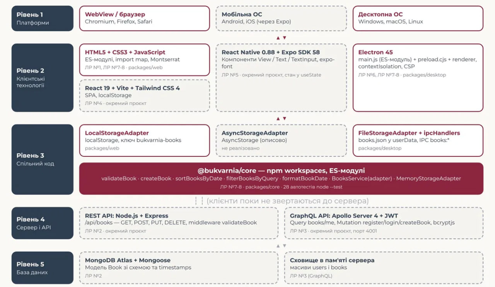

# Букварня — застосунок книгарні

Лабораторні роботи з дисципліни «Кросплатформне програмування». Застосунок книгарні.
**Букварня**: веб, мобільний і десктопний клієнти навколо спільного ядра `@bukvarnia/core`.

Автор: Маргарита Булгакова aka [@xriks](https://github.com/xriks)

## Лабораторні роботи

| № | Що реалізовано | Технології | Де зберігаються дані | Папка |
|---|---|---|---|---|
| 1 | Адаптивна вебсторінка книгарні | HTML5, CSS3, JavaScript | не зберігаються | [lab1](https://github.com/xriks/CPP-Bulhakov/tree/main/lab1) |
| 2 | REST API книг (CRUD, валідація) | Node.js, Express, Mongoose | MongoDB Atlas | [lab2](https://github.com/xriks/CPP-Bulhakov/tree/main/lab2) |
| 3 | GraphQL API з реєстрацією, входом і захищеними мутаціями | Apollo Server 4, JWT, bcryptjs | пам'ять сервера | [lab3](https://github.com/xriks/CPP-Bulhakov/tree/main/lab3) |
| 4 | Односторінковий застосунок | React 19, Vite, Tailwind CSS 4 | `localStorage` | [lab4](https://github.com/xriks/CPP-Bulhakov/tree/main/lab4) |
| 5 | Мобільний застосунок | React Native, Expo SDK 58 | стан `useState` | [lab5](https://github.com/xriks/CPP-Bulhakov/tree/main/lab5) |
| 6 | Десктопний застосунок | Electron 45, IPC | JSON-файл | [lab6](https://github.com/xriks/CPP-Bulhakov/tree/main/lab6) |
| 7–8 | Монорепозиторій: спільне ядро, веб і десктоп, тести | npm workspaces, ES-модулі, `node --test` | `localStorage` / `books.json` | [lab7-8](https://github.com/xriks/CPP-Bulhakov/tree/main/lab7-8) |

## Архітектурна схема проєкту

## Технологічний стек і компетентності

### Стек за рівнями архітектури

| Рівень | Технології | ЛР | Де реалізовано |
|---|---|---|---|
| 1. Платформи | Браузер/WebView, Android/iOS (Expo), Windows/macOS/Linux | 1, 5, 6 | — |
| 2. Клієнтські технології | HTML5 + CSS3 + JS, React 19 + Vite + Tailwind, React Native + Expo, Electron | 1, 4, 5, 6, 7–8 | [packages/web](https://github.com/xriks/CPP-Bulhakov/tree/main/lab7-8/packages/web), [packages/desktop](https://github.com/xriks/CPP-Bulhakov/tree/main/lab7-8/packages/desktop), [lab4](https://github.com/xriks/CPP-Bulhakov/tree/main/lab4), [lab5](https://github.com/xriks/CPP-Bulhakov/tree/main/lab5), [lab6](https://github.com/xriks/CPP-Bulhakov/tree/main/lab6) |
| 3. Спільний код | `@bukvarnia/core`, адаптери сховища, 28 автотестів | 7–8 | [packages/core](https://github.com/xriks/CPP-Bulhakov/tree/main/lab7-8/packages/core) |
| 4. Сервер і API | Express (REST), Apollo Server + JWT (GraphQL) | 2, 3 | [lab2](https://github.com/xriks/CPP-Bulhakov/tree/main/lab2), [lab3](https://github.com/xriks/CPP-Bulhakov/tree/main/lab3) |
| 5. База даних | MongoDB Atlas + Mongoose, сховище в пам'яті | 2, 3 | [lab2](https://github.com/xriks/CPP-Bulhakov/tree/main/lab2), [lab3](https://github.com/xriks/CPP-Bulhakov/tree/main/lab3) |

### Історія проєкту

| | |
|---|---|
| **Назва проєкту** | Букварня |
| **Проблема** | Облік книг у книгарні (додавання, пошук, сортування, видалення) для продавця, який працює з різних пристроїв. |
| **Моя роль і внесок** | Єдина розробниця: клієнти для трьох платформ, REST і GraphQL API, спільне ядро, тести, монорепозиторій. |
| **Обраний стек технологій** | JavaScript на всіх рівнях — одна мова й одні правила валідації. React + Vite дає швидкий SPA, Expo запускає мобільний клієнт без нативних збірок, Electron повторно використовує веб-код на десктопі. npm workspaces об'єднують пакети без зайвих інструментів. REST (Express) простий для CRUD, GraphQL — для гнучких запитів і JWT-авторизації. |
| **Найскладніший кросплатформний виклик і рішення** | Логіка залежала від платформи: localStorage у браузері, файл в Electron. Рішення — ядро працює з контрактом `load()/save()`, а конкретне сховище передається адаптером. Зміна `validateBook` одразу діє у веб- і десктоп-клієнтах. |
| **Здобуті знання та вміння** | Монорепозиторій і npm workspaces; ES-модулі; юніт-тести; React + Tailwind; React Native + Expo; Electron (main/preload/renderer, IPC, `contextIsolation`, CSP); REST; GraphQL + JWT + bcrypt; MongoDB/Mongoose; проєктування шарової архітектури. |

## Вимоги

- Node.js 20.6 або новіший та npm
- ЛР №2: підключення до MongoDB
- ЛР №3: змінна середовища `JWT_SECRET`
- ЛР №5: смартфон із Expo Go або емулятор

## Посилання

[GitHub-репозиторій](https://github.com/xriks/CPP-Bulhakov)
